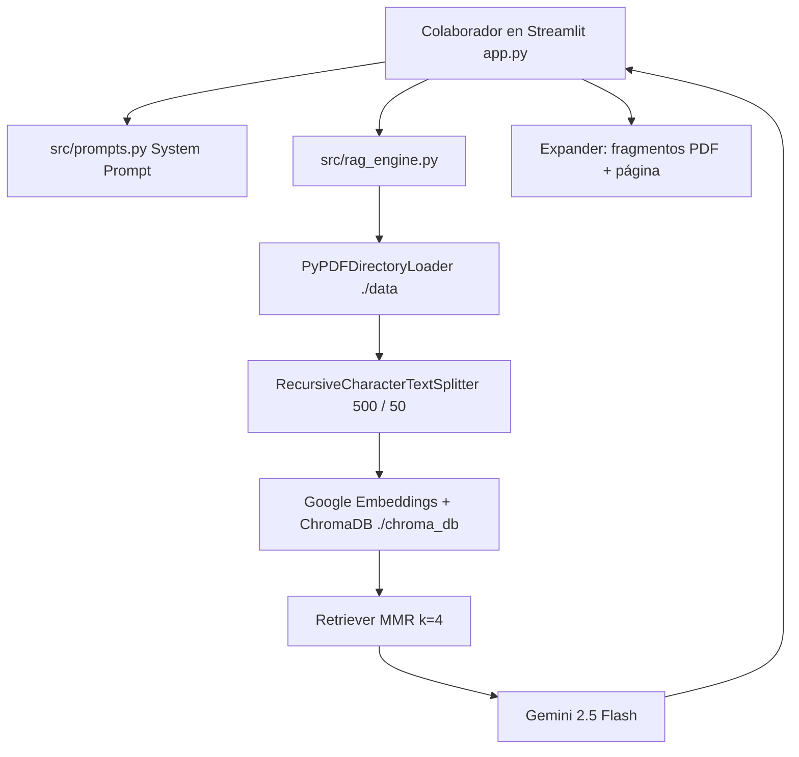

# IntegraBot — Copiloto RAG de RRHH y Cumplimiento Laboral

Sistema de **Retrieval-Augmented Generation (RAG)** para **IntegraServicios S.A.** El asistente **IntegraBot** responde consultas de colaboradores sobre el Reglamento Interno (RIOHS), el Contrato Colectivo y extractos del Código del Trabajo / Ley Karin, **citando la fuente** y **sin inventar** montos, plazos ni artículos.

Repositorio: [https://github.com/DeboradorDeMundos/integraservicios-rrhh](https://github.com/DeboradorDeMundos/integraservicios-rrhh)

---

## 1. Diagnóstico organizacional y propuesta de valor (IE1)

Gestión de Personas de IntegraServicios S.A. recibe del orden de **750 tickets mensuales** (beneficios, permisos, reglamento, normativa). Gran parte son consultas repetitivas que hoy esperan cola humana, con riesgo de respuestas informales o desactualizadas.

| Problema actual | Meta del copiloto |
| --- | --- |
| Alta carga operativa en RRHH (≈750 tickets/mes) | Autogestión de consultas frecuentes 24/7 |
| Latencia de días en respuestas rutinarias | Respuesta objetivo **< 5 segundos** (índice local + Gemini 2.5 Flash) |
| Riesgo de alucinación jurídica | **0% invención**: si no está en el contexto, se deriva a Gestión de Personas |

IntegraBot no reemplaza a RRHH en casos complejos (finiquitos litigiosos, sumarios, etc.): los **escala** con la frase institucional de derivación.

---

## 2. Arquitectura desacoplada (IE4)

La interfaz, el motor RAG y los datos viven en módulos separados.



Flujo:

1. `generate_data.py` crea PDFs internos (RIOHS, Contrato Colectivo) y externos (Código del Trabajo / Ley Karin).
2. `src/rag_engine.py` fragmenta, vectoriza e indexa **una vez** en ChromaDB local.
3. Cada pregunta recupera 4 fragmentos (MMR) y Gemini responde **solo** con ese contexto.
4. `app.py` muestra la respuesta, las citas y el expander de trazabilidad.

```
integraservicios-rrhh/
├── data/                         # Corpus dual (interno + externo)
├── src/
│   ├── __init__.py
│   ├── prompts.py                # IE2: rol, inyección dual, anti-alucinación
│   ├── rag_engine.py             # IE3: carga, chunking, Chroma, cadena LCEL
│   └── errors.py                 # Mensajes de error para el usuario
├── app.py                        # IE5: chat, historial y fuentes
├── generate_data.py
├── requirements.txt
├── .env.example
├── .gitignore
└── README.md
```

---

## 3. Ingeniería de prompts (IE2)

El System Prompt (`src/prompts.py`) usa `PromptTemplate` de LangChain con:

- **Rol:** IntegraBot, Copiloto de RRHH y Cumplimiento Laboral de IntegraServicios S.A.
- **Inyección dual:** `{context}` (fragmentos ChromaDB) + `{question}` (consulta).
- **Anti-alucinación:** si el dato no está explícito en el contexto, responde **exactamente**:

> No dispongo de la información oficial en los manuales de la empresa ni en el Código del Trabajo para responder con certeza. He derivado tu consulta al equipo de Gestión de Personas.

- **Citación estricta:** `[Fuente: RIOHS_IntegraServicios_2026.pdf, Art. 12]`

---

## 4. Pipeline RAG dual (IE3)

| Capa | Implementación |
| --- | --- |
| Carga | `PyPDFDirectoryLoader("./data")` |
| Chunking | `RecursiveCharacterTextSplitter(chunk_size=500, chunk_overlap=50)` con separadores `Artículo` / `Cláusula` |
| Embeddings | `GoogleGenerativeAIEmbeddings(model="gemini-embedding-001")` |
| Vector store | ChromaDB persistente en `./chroma_db` |
| Retriever | MMR, `k=4`, `lambda_mult=0.75` |
| LLM | `ChatGoogleGenerativeAI(model="gemini-2.5-flash", temperature=0.1)` |

Corpus dual:

| Tipo | Archivo | Contenido mínimo de rúbrica |
| --- | --- | --- |
| Interno | `RIOHS_IntegraServicios_2026.pdf` | Jornadas, licencias médicas, EPP, denuncia Ley Karin |
| Interno | `Contrato_Colectivo_2026.pdf` | Aguinaldo Fiestas Patrias, bono de escolaridad, días administrativos pagados |
| Externo | `Codigo_del_Trabajo_Chile.pdf` | Descanso dominical, finiquitos, horas extraordinarias + Ley Karin |

**Nota de embeddings:** la API de Google ya no sirve `models/embedding-001` (HTTP 404). El proyecto usa el sucesor oficial `gemini-embedding-001`, compatible con Google AI Studio.

---

## 5. Requisitos

- Python 3.10 o superior
- Clave gratuita de [Google AI Studio](https://aistudio.google.com/apikey) (`GOOGLE_API_KEY`)

---

## 6. Instalación

```bash
git clone https://github.com/DeboradorDeMundos/integraservicios-rrhh.git
cd integraservicios-rrhh
```

Entorno virtual:

```bash
python -m venv venv

# Windows
venv\Scripts\activate
# si python no se reconoce: py -m venv venv

# macOS / Linux
source venv/bin/activate
```

Dependencias (`langchain-google-genai` / `google-genai`):

```bash
pip install -r requirements.txt
```

---

## 7. Configuración de la API Key

```bash
# Windows (PowerShell)
copy .env.example .env

# macOS / Linux
cp .env.example .env
```

Contenido de `.env`:

```
GOOGLE_API_KEY=tu_api_key_de_google_ai_studio
```

El archivo `.env` **no se sube a GitHub** (está en `.gitignore`, junto con `venv/` y `chroma_db/`).

---

## 8. Ejecución

```bash
python generate_data.py
streamlit run app.py
```

La primera indexación puede tardar unos segundos. Las siguientes reutilizan `./chroma_db`. La UI queda en [http://localhost:8501](http://localhost:8501).

---

## 9. Trazabilidad en la interfaz (IE5)

Bajo cada respuesta hay un expander:

**Ver fuentes documentales consultadas (RAG)**

Muestra el PDF de origen, el número de página y el fragmento exacto recuperado de ChromaDB. Si Gemini no tiene evidencia, no cita datos inventados: deriva a Gestión de Personas.

Preguntas de demostración:

- ¿Cuál es el valor del bono de colación?
- ¿Cuántos días administrativos pagados tengo?
- ¿Cuánto es el bono de escolaridad?
- ¿Cómo se denuncian hechos de acoso laboral?
- ¿Cómo se calculan las horas extraordinarias?
- ¿Mañana va a llover? ← debe derivar, no inventar el clima

---

## 10. Errores visibles vs. técnicos

La UI no muestra tracebacks. `src/errors.py` traduce fallas de red, cupo, clave o documentos faltantes a avisos institucionales, con botón de reintento. El detalle técnico queda en la consola.

---

## Licencia de uso académico

Proyecto de evaluación. Los PDFs son **simulados** y no sustituyen el texto oficial del Código del Trabajo ni los instrumentos reales de la empresa.
